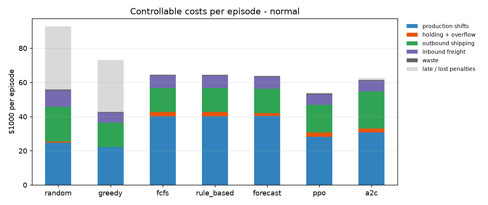
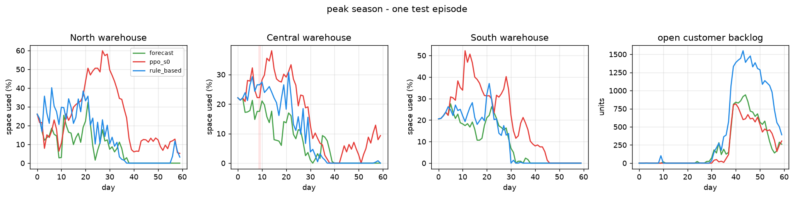
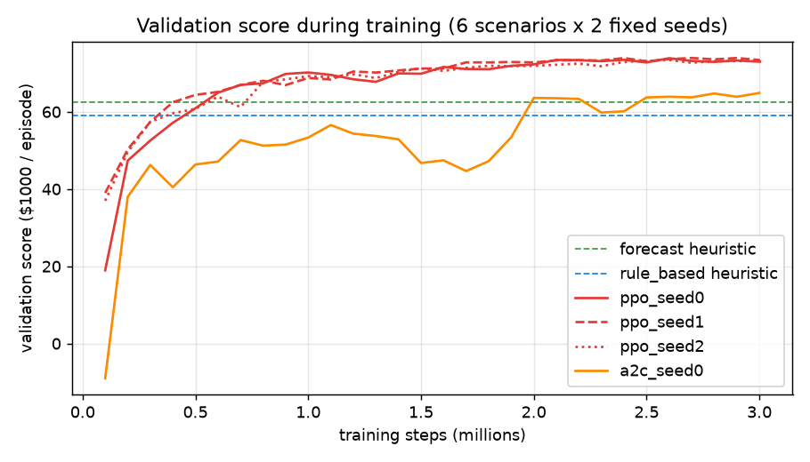

# Supply Chain Planner - RL environment + evaluation benchmark

A supply chain simulator with a Gymnasium interface, five hand-written planning baselines, PPO / A2C agents
(Stable-Baselines3) and an evaluation suite that scores every policy on 7 disruption scenarios with 40+ business
KPIs (service, inventory, money, operations, CO2).

The question I wanted to answer: *a static reorder rule is fine on a normal day, but what happens when a warehouse
shuts down or Black Friday hits - can an RL planner learn to adapt, and can we measure that properly?*

**Results in short:** PPO trained on a mix of 6 scenarios scores **116** on a scale where random = 0 and the best
hand-written heuristic = 100. It beats every baseline in every scenario, including a held-out "compound crisis" it
never saw during training. Over 30 paired test episodes per scenario it earned $8.7k-$15.2k more per 60-day
episode than the forecast heuristic (+17% on average) and scored higher in all 210 of them. Most of the gain comes
from smarter production planning (fewer overtime shifts, more buffer stock), not from better service. The three
training seeds land within 2 points of each other.


## The simulated company

```
Supplier (3 production lines, finite capacity, paid shifts)
   |  lead time 2-4 days (or expedited 1-2 days at 3x freight)
   v
North / Central / South warehouses (limited space, perishable stock tracked by expiry date)
   |  own trucks (paid per trip, part-loads billed LTL) or express parcel (per unit, faster)
   v
Customers in 3 regions (Poisson orders, 25% high priority promised next day, others in 3 days)
```

* **3 products** with different economics: fresh milk (cheap, expires after 12 days), cereal (45 days), blenders
  (expensive, big, never expire).
* **One step = one day, 60 days per episode.** Orders that wait too long get cancelled (lost sale).
* Single-shift supplier capacity is *below* average demand on purpose, so overtime is a real decision.
* Random background events (supplier delays, damaged deliveries, demand spikes, short outages, trucking slowdowns)
  plus the big scenario events below.

Full spec (observation fields, action encoding, reward, timeline of a day): [docs/environment.md](docs/environment.md)

**Observation** (94 floats): stock on hand / in transit / ordered per warehouse and product, customer backlog and
overdue orders, units about to expire, 7-day demand forecast and recent demand, warehouse status and space used,
supplier capacity, known delays, fuel surcharge, day of week, cash.

**Action** (MultiDiscrete, 19 dims): order 0-4 lots per warehouse x product, expedite or not, shift level per
production line, one transfer per product between any two warehouses, and three fulfilment rules (FCFS vs. priority,
local vs. flexible sourcing, truck vs. smart vs. express).

**Reward** = what the business earns that day: revenue - cost of goods sold - wasted goods - shift, freight,
transport, holding, overflow and disposal costs - late-delivery and lost-sale penalties. Goods are charged when sold
(accrual accounting), so the rewards of an episode add up exactly to profit minus service penalties, which is also
the benchmark score.

## Scenarios

| scenario | what happens | used for |
|---|---|---|
| normal | business as usual (background noise only) | train + test |
| peak_season | demand ramps to +80% from day 20, Black Friday doubles it again on days 38-39, plus a surprise flash sale in the South | train + test |
| supply_shortage | supplier at 40% capacity for days 15-35, shipments 2 days late | train + test |
| transport_disruption | trucks +2 days and +40% cost for two weeks, parcel strike in the middle | train + test |
| warehouse_failure | Central (biggest warehouse) closed for days 18-30 | train + test |
| multi_warehouse | unbalanced network: big cheap hub in the middle, demand in small expensive warehouses | train + test |
| compound_crisis | season + supplier problems + outage + transport issues, noisier background | **test only** (held out) |

Training and test use different seeds. Every agent is tested on the same seeds, and customers / disruptions don't
depend on what the agent does, so all agents face exactly the same episodes.

## Baselines

| agent | idea |
|---|---|
| random | uniform random actions |
| greedy | myopic just-in-time: covers only lead-time demand, no safety stock, never pays overtime or express |
| fcfs | static (s, S) reorder policy, serves orders first-come-first-serve, trucks only |
| rule_based | same (s, S) policy, but high-priority orders first and "smart" express |
| forecast | base-stock policy on the 7-day forecast with safety stock, expediting when it saves >= 2 stockout days, rebalancing transfers, cross-shipping only when a warehouse is down or orders are piling up, re-plans a closed warehouse's demand at the nearest open one |

The baselines get the same observation as the RL agent (decoded back to units), plus static network data such as
lead times and lot sizes.

## RL agents

PPO and A2C from Stable-Baselines3 (`MlpPolicy`, 2x256 for both actor and critic), trained for 3M steps on a mix of
the 6 training scenarios (a random scenario per episode), 16 parallel envs, observation + reward normalisation
(`VecNormalize`). Every 100k steps the deterministic policy is validated on fixed episodes (6 scenarios x 2 seeds,
different from the test seeds) and the best checkpoint is kept together with its normalisation statistics.
Hyperparameters: [configs/train_ppo.yaml](configs/train_ppo.yaml), [configs/train_a2c.yaml](configs/train_a2c.yaml).

## Results

30 test episodes per scenario (seeds 10000-10029, never used for training or validation), the same episodes for
every agent. PPO = mean of 3 training seeds. All tables: [results/benchmark/leaderboard.md](results/benchmark/leaderboard.md),
more analysis in [notebooks/02_results_analysis.ipynb](notebooks/02_results_analysis.ipynb). The evaluation is fully
deterministic: running `evaluate.py` twice gave identical numbers for all 1890 episodes.

Score in $1000 per 60-day episode (profit minus late / lost-sale penalties):

| agent | normal | peak season | supply shortage | transport | warehouse failure | multi-warehouse | compound crisis (held out) | normalised |
|---|---|---|---|---|---|---|---|---|
| **PPO (3 seeds)** | **79.5** | **91.3** | **46.9** | **74.5** | **73.2** | **77.8** | **64.9** | **116.2** |
| A2C | 71.3 | 73.8 | 36.2 | 68.8 | 66.0 | 72.9 | 52.1 | 102.5 |
| forecast heuristic | 70.1 | 76.0 | 35.6 | 65.5 | 64.5 | 68.6 | 53.3 | 100.0 |
| rule-based (s, S) | 69.6 | 67.1 | 38.2 | 65.2 | 53.7 | 67.8 | 53.0 | 96.0 |
| FCFS | 69.3 | 57.5 | 34.5 | 61.2 | 53.4 | 67.5 | 44.2 | 91.4 |
| greedy | 45.6 | -10.4 | -7.0 | 33.1 | 41.1 | 42.8 | -17.2 | 40.4 |
| random | 18.1 | -52.4 | -23.8 | 9.6 | 15.4 | 17.0 | -39.7 | 0.0 |

The individual PPO seeds score 115.5, 115.8 and 117.3 (normalised).

**PPO vs. the forecast heuristic, paired** (difference on the same episode, so the luck of the episode cancels out):

| scenario | PPO - forecast ($1000 / episode) | 95% CI | episodes where PPO scored higher |
|---|---|---|---|
| normal | +9.5 | ±0.4 | 30 / 30 |
| peak season | +15.2 | ±1.4 | 30 / 30 |
| supply shortage | +11.4 | ±1.1 | 30 / 30 |
| transport disruption | +9.0 | ±0.5 | 30 / 30 |
| warehouse failure | +8.7 | ±0.4 | 30 / 30 |
| multi-warehouse | +9.2 | ±0.6 | 30 / 30 |
| compound crisis (held out) | +11.6 | ±1.6 | 30 / 30 |

### What did PPO actually learn?

Where the extra money comes from, PPO minus forecast heuristic in $1000 per episode (positive = PPO better):

| scenario | gross margin | production shifts | inbound freight | outbound + transfers | holding | waste | penalties | total |
|---|---|---|---|---|---|---|---|---|
| normal | -0.6 | +12.2 | +0.9 | -1.8 | -0.9 | -0.1 | -0.3 | +9.5 |
| peak season | +3.1 | +1.8 | +4.6 | -0.6 | -1.0 | -0.1 | +7.4 | +15.2 |
| supply shortage | +0.3 | +6.2 | +4.1 | -3.2 | -0.4 | -0.1 | +4.5 | +11.4 |
| warehouse failure | -0.5 | +11.5 | +1.1 | -0.8 | -0.6 | -0.8 | -1.1 | +8.7 |
| compound crisis | +1.1 | +2.4 | +5.3 | -0.6 | -1.0 | -0.2 | +4.6 | +11.6 |
| **average (all 7)** | +0.2 | **+8.3** | +2.8 | -1.6 | -0.7 | -0.2 | +1.9 | **+10.7** |

* **Production smoothing is the big one.** The heuristic pays for a double shift whenever the supplier queue is
  longer than a single shift can clear (74% of line-days). PPO does it on ~42%, keeps ~54% more stock on hand as a
  buffer (449 vs. 291 units on average) and uses 95% of the production capacity it pays for (heuristic: 82%).
  
* **It builds stock before the peak.** In peak season it fills the warehouses before the demand ramp, sells more
  (+$3.1k margin) and pays $7.4k less in penalties. High-priority on-time rate in peak season: 92.7% vs. 88.4%.
  
* **Less expediting, more express and transfers.** It expedites supplier orders on ~12% of days (heuristic 21%), but
  ships 13.6% of units by express parcel (2.6%) and moves ~2,260 units per episode between warehouses (~120).
* **The trade-off is real.** On calm days PPO lets a few more orders run late (on-time-in-full in the normal
  scenario 98.0% vs. 99.3%), wastes more stock (117 vs. 84 units per episode) and turns its stock over less often. A
  late carton of milk costs $0.60/day in the reward, and PPO takes that literally. Overall it still loses fewer
  sales (189 vs. 234 units per episode) and the customer satisfaction score is about the same (94.1 vs. 93.7).
  If the business cares more about on-time delivery, that's a reward-weight decision, not a modelling bug.
* CO2: 13% less than the forecast heuristic (mostly less expedited freight). The static rule-based policy still
  emits less (55.7 t vs. 60.5 t per episode), and the lean greedy policy the least (49.1 t), at a big loss of money.

### Other findings

* **A2C is only marginally better than the heuristic (102.5).** Clearly better in transport disruption and
  multi-warehouse, worse in peak season (-$2.2k ± 1.7k) and no better in the compound crisis. It needed 2M steps to
  reach the heuristic's validation score, PPO needed 0.5-0.6M.
* **Prioritising high-priority orders** (rule-based vs. FCFS) is worth +$9.6k in peak season and +$8.8k in the
  compound crisis, but only +$0.3k on a normal day.
* **Forecast awareness and re-routing** (forecast vs. rule-based) is worth +$10.8k when a warehouse fails and +$8.9k
  in peak season, but the static rule is $2.6k *better* in the supply shortage.
* **Lean planning without safety stock** (greedy) loses money in peak season, supply shortage and the compound
  crisis. The random policy ends 10 of 30 peak-season episodes in an inventory collapse.

### Training



All three PPO seeds pass the forecast heuristic's validation score after 0.5-0.6M steps (~10 minutes) and level off
around 73-74k. A 3M-step run takes ~40 minutes on my laptop CPU (20 threads), ~60 minutes with two runs in parallel.

## Evaluation framework

`evaluate.py` runs every agent on every scenario and computes ([evals/metrics.py](evals/metrics.py)):

* **service** - fill rate, on-time-in-full rate (overall and high priority), average delay, customer satisfaction
  score, lost units, split shipments
* **inventory** - average stock (units and $), annualised turnover, stockout rate, overstock rate, waste
* **financial** - revenue, COGS, holding, shipping, inbound freight, production, waste cost, penalties, accrual and
  cash profit, score
* **operational** - warehouse utilisation, overflow days, truck utilisation, average delivery distance, production
  efficiency, express share, transfers, rejected supplier orders
* **sustainability** - CO2, fuel, packaging
* **behaviour** - how often the policy picked each rule / shift level (to see *what* it learned)

`evals/leaderboard.py` aggregates that into normalised scores (0 = random, 100 = forecast heuristic), 95% confidence
intervals (t-distribution) and paired comparisons (same seeds -> per-seed differences). Full tables:
[results/benchmark/leaderboard.md](results/benchmark/leaderboard.md).

There's also a Streamlit dashboard (`streamlit run dashboard/app.py`) with the leaderboard, inventory over time per
warehouse, demand vs. forecast, backlog / lost sales, cost breakdown, cumulative reward, a shipment timeline and the
production shifts the agent picked, for any saved episode.

## Quickstart

```bash
python -m venv .venv
.venv\Scripts\activate          # Windows (source .venv/bin/activate on Linux/Mac)
pip install -r requirements.txt

pytest                                            # 88 tests, ~20 s
python scripts/demo.py --agent forecast --scenario warehouse_failure --every 5
python evaluate.py --episodes 5 --out results/baselines          # baselines only, ~1 min

python train.py --config configs/train_ppo.yaml --seed 0 --run-name ppo_seed0   # ~40 min on a laptop CPU
python train.py --config configs/train_ppo.yaml --seed 1 --run-name ppo_seed1
python train.py --config configs/train_ppo.yaml --seed 2 --run-name ppo_seed2
python train.py --config configs/train_a2c.yaml --seed 0 --run-name a2c_seed0
python evaluate.py --rl ppo_s0=runs/ppo_seed0 ppo_s1=runs/ppo_seed1 ppo_s2=runs/ppo_seed2 a2c=runs/a2c_seed0 --episodes 30
python scripts/make_figures.py --results results/benchmark --runs runs/ppo_seed0 runs/ppo_seed1 runs/ppo_seed2 runs/a2c_seed0
streamlit run dashboard/app.py
```

Using the env directly:

```python
import gymnasium as gym
import scsim  # registers SupplyChain-v0

env = gym.make("SupplyChain-v0")   # default config = "normal" scenario
obs, info = env.reset(seed=0)
obs, reward, terminated, truncated, info = env.step(env.action_space.sample())

from evals.scenarios import make_env
env = make_env("peak_season")                       # one scenario
env = make_env(["normal", "warehouse_failure"])     # random scenario per episode
```

## Project structure

```
scsim/                  the simulator
  environment.py        SupplyChainEnv (Gymnasium), daily timeline, reward, termination
  inventory.py          stock by expiry date (FEFO, spoilage) + in-transit pipeline
  warehouse.py          capacity, holding / overflow cost
  supplier.py           make-to-order production queue with shift levels
  logistics.py          lanes, trucks (FTL / LTL billing), express parcels, transfers
  demand.py             customer orders + forecast
  events.py             random and scheduled disruptions
  orders.py             order book, allocation / sourcing / carrier rules, cancellations
  spaces.py             action + observation layouts
  tracker.py            episode logging
agents/                 random, heuristics (rule_based, fcfs, greedy, forecast), RL wrapper
rl/                     training helpers: validation callback, torch-free subprocess vec env
evals/                  scenarios, metrics, runner, leaderboard
configs/                default.yaml, scenarios/*.yaml, train_*.yaml
dashboard/app.py        Streamlit dashboard
notebooks/              env walkthrough, results analysis
scripts/                demo.py (watch an episode), make_figures.py
tests/                  pytest suite
train.py, evaluate.py
```

## Design notes (and things that went wrong)

* **Money as reward, not event bonuses.** The original idea was a table of bonuses (+10 order fulfilled, -15
  stockout, ...). A late blender ($150) and a late carton of milk ($12) are not the same though, and with dollars
  the trade-offs (overtime vs. lost sales, express vs. late penalty) are well defined.
* **Accrual instead of cash accounting for the reward.** With cash accounting, the score over a 60-day window would
  reward ending the episode with empty shelves (stock bought on day 59 is pure cost, the sales come after the
  window). Charging goods when they are sold or wasted makes the episode reward equal to accounting profit with
  inventory valued at cost (tested in `tests/test_accounting.py` together with unit conservation).
* **Time limit = truncation, no "days left" in the observation**, so the policy is stationary and SB3 bootstraps the
  value at the cut instead of treating day 60 as the end of the world.
* **Common random numbers.** Customers and disruptions are generated from their own random streams at reset, so all
  agents see identical episodes, and comparisons can be paired per episode. Measured on the benchmark: for PPO and
  the heuristics the paired difference to the forecast heuristic is about 2-2.5x less noisy than comparing two
  averages (a hard episode is hard for everybody). It doesn't help for random / greedy, whose results barely
  correlate with the other policies.
* **Bug: cross-shipping looked absurdly expensive.** At first every truck was billed as a full truck, so sending one
  blender to the neighbouring region cost a whole 300 km trip and every policy that cross-shipped looked terrible.
  Part-loads are now billed like LTL freight (pro rata with a premium and a minimum charge).
* **Bug: flexible sourcing stole stock.** In flexible mode an order could take the last units of another warehouse
  that its own customers needed the same day. Fulfilment now runs in two passes (home warehouse first, then
  cross-shipping from what's left).
* **Bug: stockouts were under-counted.** The daily log was written after the overnight deliveries were unloaded, so
  a warehouse that sold out but got a truck the next morning never showed up as a stockout.
* **VecNormalize + best checkpoint.** SB3's normal eval callback saves the best model but not the observation
  statistics from that moment, so the "best" model would be paired with statistics from the end of training. The
  validation callback here saves both together.
* **Out of memory.** Starting a second training run next to the first one crashed it with a numpy
  `ArrayMemoryError`. Two reasons: on Windows every env worker is a freshly spawned Python process and SB3's
  worker loads torch in each of them, and numpy's OpenBLAS reserves a buffer per CPU thread in *every* process
  (~650 MB of committed memory each on my 20-thread laptop). 2 runs x 16 workers was too much. Fix: a small
  torch-free worker with the same message protocol as SB3's (`rl/env_worker.py`, a test checks it gives exactly
  the same results as SB3's `DummyVecEnv`) and `OPENBLAS_NUM_THREADS=1` - a worker now commits ~60 MB instead
  of ~670 MB.
* **Training speed.** The first runs did ~300 steps/s. Profiling showed most of the time went into the policy's
  forward pass during rollouts, not the env or the gradient updates. What helped: not running two trainings at once
  (they fought over the CPU), 16 instead of 8 parallel envs (half as many forward passes per sample), and turning off
  torch's argument validation for distributions - the MultiDiscrete head creates 19 `Categorical` objects per
  forward pass and validating them was ~30% of its time. Now ~1300 steps/s.

## Limitations / ideas for later

* The baselines are heuristics I wrote myself, and their parameters (safety factor, cross-shipping threshold) are
  rough guesses, not tuned. A tuned heuristic or a proper optimisation baseline (rolling-horizon MILP /
  stochastic programming with the true demand model) would be a much tougher opponent than "beats my heuristics".
* PPO has 3 training seeds, A2C only 1, and neither had any real hyperparameter tuning (A2C probably deserves more).
* The network size is fixed (3 warehouses x 3 products), a policy can't transfer to a different network. A graph
  neural network policy over warehouses / lanes could.
* No DQN / Rainbow: the action space has ~4 x 10^11 combinations, so it would need an action-branching variant.
* Simplifications: no stock reservation for future high-priority orders, no holding cost in transit, one supplier,
  no pricing decisions, synthetic demand.
* Future: multi-agent version (one agent per warehouse), supplier negotiation, dynamic pricing, carbon-aware
  shipping, an LLM "planning assistant" that explains the agent's decisions.
