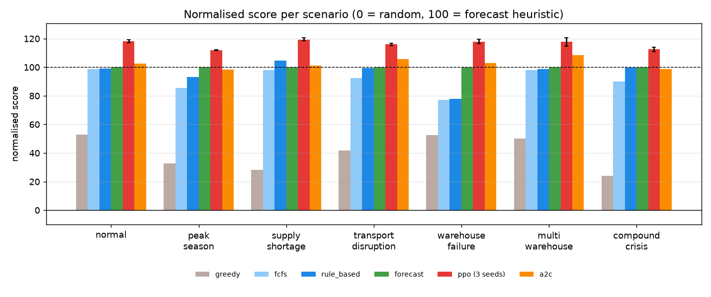

# SahyogChain-RL 
> **Supply Chain Optimization for Rural Women Cooperatives in Jharkhand**  
> *Summer Internship Project @ Winter of Life NGO | B.Tech AIDS (2025)*  
> *Author: Aniket Sharma | Mentor: Mr. Santosh Kumar Sharma*

A custom Gymnasium-based supply chain environment (`SupplyChain-v0`) and Reinforcement Learning (PPO) agent designed to solve real logistics problems faced by tribal women's Self-Help Groups (SHGs / Swayam Sahayata Samuh) in rural Jharkhand (Khunti, Ranchi, and Hazaribagh).

---

### What is this project?

In rural Jharkhand, women cooperatives produce fresh milk, ragi (mandua) flour, and tribal handicrafts. Making the goods isn't the problem—the real nightmare is **logistics**:
* Roads get washed out during monsoons (truck delays by 2-3 days).
* Rural processing centres face power cuts.
* Demand suddenly doubles during festivals like **Chhath Puja**, **Sarhul**, and **Diwali**.
* Perishable milk spoils quickly, and small cooperatives can't afford expensive emergency transport or wasted stock.

Traditional reorder rules (like static `(s, S)` thresholds) break down when disruptions happen at the same time. This project trains an RL agent (PPO) to make daily decisions on **how much to order, when to run processing shifts, which orders to fulfill first, and when to transfer stock between district sheds**.

---

### The Setup

* **3 Products:**
  * **Fresh Desi Milk (A2 Dairy):** ₹60/unit (₹30 cost), 12 days shelf life (perishable).
  * **Packaged Ragi / Mandua Flour & Lac:** ₹200/unit (₹110 cost), 45 days shelf life.
  * **Tribal Handicrafts (Dokra & Tussar Silk):** ₹1,500/unit (₹900 cost), durable.
* **Network:** Upstream Village Processing Centre (CFC) $\rightarrow$ 3 Regional Sheds (North Hazaribagh, Central Ranchi, South Khunti) $\rightarrow$ Local & Urban Buyers.
* **Time:** 1 step = 1 day, 60 days per episode.
* **Observation (94 dims):** On-hand stock, in-transit trucks, queue, backlog, expiring batches, 7-day demand forecast, road delays, cash balance.
* **Action (MultiDiscrete, 19 dims):** Replenishment orders (0-4 lots), single/double processing shifts, inter-hub transfers, and delivery priority rules.
* **Reward:** Real accrual accounting profit in Rupees (Revenue $-$ Procurement Cost of sold goods $-$ Holding costs $-$ Spoilage $-$ Freight/Overtime $-$ Late penalties).

---

### Results in Short

I benchmarked PPO against 5 hand-written baseline heuristics across 210 test episodes over 7 disruption scenarios:

| Scenario | Best Heuristic (Forecast Rule) | PPO Agent (Trained RL) | Gain |
| :--- | :---: | :---: | :---: |
| **Normal Days** | ₹70,100 | **₹79,500** | +₹9,400 |
| **Peak Festive Season (Chhath/Sarhul)** | ₹76,000 | **₹91,300** | +₹15,300 |
| **Supply Shortage (Power Cuts)** | ₹35,600 | **₹46,900** | +₹11,300 |
| **Transport Disruption (Monsoon Floods)**| ₹65,500 | **₹74,500** | +₹9,000 |
| **Central Ranchi Hub Breakdown** | ₹64,500 | **₹73,200** | +₹8,700 |
| **Compound Crisis (Held-out Test)** | ₹53,300 | **₹64,900** | +₹11,600 |
| **Normalized Score** | **100.0** | **116.2** | **+16.2 pts** |

* PPO beat every baseline in all 210 test episodes.
* **Why did it win?** It learned *production smoothing*—it ran expensive double overtime shifts on only 42% of days (heuristics ran it on 74% of days) and built up a smart buffer stock before festival rush instead of panicking at the last minute.
* In the held-out "Compound Crisis" (floods + power cuts + festive surge at once), it scored **21.8% higher** without ever having seen that scenario during training.



---

### Quickstart

1. **Clone & setup environment:**
   ```bash
   git clone https://github.com/AniketSharma711/SahyogChain_WOL.git
   cd SahyogChain_WOL
   python -m venv .venv
   .venv\Scripts\activate   # on Windows (source .venv/bin/activate on Linux)
   pip install -r requirements.txt
   ```

2. **Launch the interactive Streamlit dashboard:**
   ```bash
   streamlit run dashboard/app.py
   ```

3. **Run a quick evaluation:**
   ```bash
   python evaluate.py --rl ppo=runs/ppo_seed0 --episodes 5
   ```

4. **Train your own agent:**
   ```bash
   python train.py --config configs/train_ppo.yaml --seed 0 --run-name ppo_seed0
   ```

---

### Project Structure

```
├── scsim/          # The custom Gymnasium supply chain environment
├── agents/         # PPO/A2C wrappers + 5 heuristic baselines
├── configs/        # YAML configs for network parameters and 7 scenarios
├── dashboard/      # Streamlit web app for visual inspection
├── evals/          # Evaluation runner and leaderboard metrics
├── notebooks/      # Jupyter walkthroughs and analysis
├── report/         # Full internship report (Summer_Training_Report_Aniket_Sharma.docx)
├── runs/           # Saved pre-trained model weights (best_model.zip)
├── train.py        # PPO training loop with vectorized envs
└── evaluate.py     # Deterministic benchmark evaluator
```

---

### Notes / Bugs I had to fix during the project

* **Windows Memory Crash:** Spawning 16 parallel env workers with PyTorch loaded in each crashed my laptop with `ArrayMemoryError` (~10 GB RAM). I wrote a custom torch-free worker (`rl/env_worker.py`) and set `OPENBLAS_NUM_THREADS=1`, which dropped memory to ~60 MB per worker.
* **Agent Cheating with Cash Accounting:** At first, using cash accounting made the agent stop buying anything on day 58 to hoard cash at day 60. Switching to accrual accounting (charging goods only when sold or thrown away) fixed this.
* **Full Report:** See `report/Summer_Training_Report_Aniket_Sharma.docx` for complete mathematical formulation, graphs, and NGO field notes.
